# 02 — Android Accessibility Fundamentals

This teaches the accessibility concepts the project relies on. Read it before the code
walkthrough; the code will make much more sense afterward.

---

## 1. What Accessibility Services are

Android lets an app register an **AccessibilityService** — a special component that the *system*
binds and feeds **accessibility events** about what is happening on screen. They exist so that
assistive technologies (screen readers like TalkBack, switch controls, magnifiers) can help people
with disabilities use any app. Because they can see other apps' UI, they are one of the most
powerful and most sensitive APIs on Android.

## 2. Why Android provides them

To make the platform usable for everyone, without each app having to build its own assistive
support. The platform exposes a **uniform description** of every screen so a service can read and
announce it.

## 3. What an accessibility event is

Whenever something interesting happens in the UI — a window changes, a view gains focus, content
changes — Android fires an **`AccessibilityEvent`**. It is a lightweight notification that says,
essentially, "something happened in package X of type Y". It does **not** itself contain the whole
screen.

## 4. What `AccessibilityEvent` represents

An object with metadata such as:
- `packageName` — which app the event came from.
- `eventType` — what kind of change (e.g. `TYPE_WINDOW_STATE_CHANGED`).
- `className`, `contentDescription`, etc.

In this project we subscribe to `typeWindowStateChanged` and `typeViewFocused`, restricted (via
`android:packageNames`) to a five-app allowlist — Google Messages, Instagram, WhatsApp, Telegram,
Signal — and then narrowed at runtime to the single app the user chose. When that app's window
becomes active, we get one qualifying event.

## 5. What `AccessibilityNodeInfo` represents

An **`AccessibilityNodeInfo`** is a description of **one UI element** as seen by accessibility
tooling: its class, bounds, whether it's clickable, and — crucially — its `text` and
`contentDescription`. Think of it as "the accessibility-visible snapshot of a view".

## 6. What an accessibility node tree is

Nodes are arranged parent → children, mirroring the screen's structure. The top node is the
**root** of a window; it has children, which have children, and so on. This is the tree our
`StructuralInspector` walks.

```
root (FrameLayout)
├── LinearLayout
│   ├── TextView  "Hello"        ← text-bearing
│   └── ImageView                ← no text
└── Button "Send"                ← text-bearing
```

## 7. Parent–child relationships

Each node reports `getChildCount()` and `getChild(i)`. We traverse downward only (root → leaves).
We never click, never request focus, never scroll — we only read structure.

## 8. View hierarchy vs accessibility hierarchy

They are related but **not identical**. The accessibility tree is a *simplified, semantic* view of
the UI. Decorative views may be merged or hidden; a custom-drawn view may expose one node with a
`contentDescription`; a `RecyclerView` may only expose the **currently rendered** items, not the
whole off-screen list. So the accessibility tree ≠ the visible screen ≠ the real data.

## 9. Active window and root node

`AccessibilityService.rootInActiveWindow` returns the `AccessibilityNodeInfo` for the window that
currently has focus. That's our entry point for a traversal.

## 10. Why `rootInActiveWindow` can return null

During window transitions, animations, permission dialogs, or when no window is focused, there may
be **no active root at that instant**. Our code treats null as a distinct, honest outcome
("root unavailable") rather than a success — see `InspectionController.handleEvent`.

## 11. Why a visible element may not expose its text

Some text is drawn as a custom canvas, an image, or is marked not-important-for-accessibility.
A node can exist and be visible while `text` and `contentDescription` are both empty. That is
exactly why "text-bearing node count" is a structural measure, not a content measure.

## 12. Why a text-bearing node is not necessarily a chat message

A node with text could be a button label, a timestamp, a username, a "Send" affordance, or a
header. Counting text nodes tells you how much text is *exposed*, not how many *messages* there
are.

## 13. Why node count ≠ message count

One message bubble may be several nodes (avatar + name + text + time), and one node may represent
many lines. There is no fixed ratio. This is the central reason this project does **not** claim to
extract conversations.

## 14. Accessibility service lifecycle

1. App declares the service in the manifest with `BIND_ACCESSIBILITY_SERVICE` and a config XML.
2. User enables it in **Settings ▸ Accessibility** (the app cannot self-enable it).
3. System binds the service and calls `onServiceConnected()`.
4. System calls `onAccessibilityEvent(event)` for each subscribed event.
5. `onDestroy()` when the user disables it or the service is torn down.

Our `ChatInspectionService` implements exactly these four callbacks and nothing more.

## 15. Why the service must be declared in the manifest

Android only binds components it knows about. The `<service>` entry with the
`android.accessibilityservice` intent filter and the config `<meta-data>` tells the system this is
an accessibility service and where to find its settings.

## 16. What the accessibility service configuration XML does

`res/xml/accessibility_service_config.xml` declares the service's capabilities and subscriptions:
- `android:accessibilityEventTypes` — which events to receive.
- `android:packageNames` — **restricts events to the app allowlist** (a platform-enforced privacy
  boundary). Only these six packages can ever reach us; `ChatInspectionService.applyTargetFilter()`
  then narrows the live subscription to the single chosen app with `setServiceInfo()`, and it only
  ever narrows — the runtime filter can never widen past this XML.
- `android:canRetrieveWindowContent` — the minimum permission to read the active window's tree.
- `android:accessibilityFlags` — `flagRetrieveInteractiveWindows`.
- `android:description` — the text shown to the user in Settings.

## 17. What `canRetrieveWindowContent` means

It is the flag that allows `rootInActiveWindow` to actually return a populated tree. Without it we
could see events but not inspect structure. We set it to `true` because structural inspection is
the whole point — and it is the *only* capability we request.

## 18. Why the user must enable the service manually

Because an accessibility service can read everything on screen, Android refuses to let an app turn
itself on. The user must do it consciously in Settings, after seeing the app's disclosure. Our UI
never tries to bypass this.

## 19. How Android version and the target app affect results

Different Android versions expose trees slightly differently, and different apps (or different
versions of the same app) set different accessibility properties. A screen that exposes lots of text
on one version may expose little on another. This variability is itself a legitimate research
finding to report — including the case where an app exposes **nothing**.

---

## 20. The relationship chain (diagram)

```mermaid
flowchart LR
  A[App under test renders a screen] --> B[Android fires AccessibilityEvent]
  B --> C[Our AccessibilityService receives it]
  C --> D[Package checked against armedTarget]
  D --> E[Service reads rootInActiveWindow]
  E --> F[Root AccessibilityNodeInfo]
  F --> G[Child nodes, recursively]
  G --> H[StructuralInspector counts labels / classes / depth]
  H --> I[InspectionResult + redacted report shown]
```



**In plain words:** the chosen app draws a screen → Android announces that event to our service → the
service checks the event's package against the one armed at Start time → only then does it ask the
system for the active window's root node → it walks down the children → the inspector tallies
structure → the app displays only the tallies.

## 21. Official references

- Accessibility Services guide — `https://developer.android.com/guide/topics/accessibility-services`
  (supports: what services are, the manifest `<service>` + config XML, and `onAccessibilityEvent`).
- `AccessibilityService` API — `https://developer.android.com/reference/android/accessibilityservice/AccessibilityService`
  (supports: `rootInActiveWindow`, `onServiceConnected`, `onDestroy`).
- `AccessibilityNodeInfo` API — `https://developer.android.com/reference/android/view/accessibility/AccessibilityNodeInfo`
  (supports: `getChildCount`, `getChild`, `getText`, `getContentDescription`, and the deprecation of
  node recycling on modern APIs).
- `AccessibilityEvent` API — `https://developer.android.com/reference/android/view/accessibility/AccessibilityEvent`
  (supports: `getPackageName`, event types).
- `AccessibilityServiceInfo` config attributes — `https://developer.android.com/reference/android/accessibilityservice/AccessibilityServiceInfo`
  (supports: `canRetrieveWindowContent`, `packageNames`, `accessibilityEventTypes`).

> Cite these in your report for the behavioural claims above. Each bullet maps a specific claim in
> this document to the page that backs it.

Next: [03_SOURCE_CODE_WALKTHROUGH.md](03_SOURCE_CODE_WALKTHROUGH.md).
