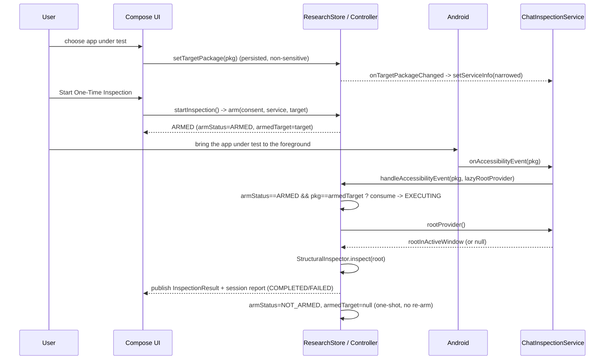
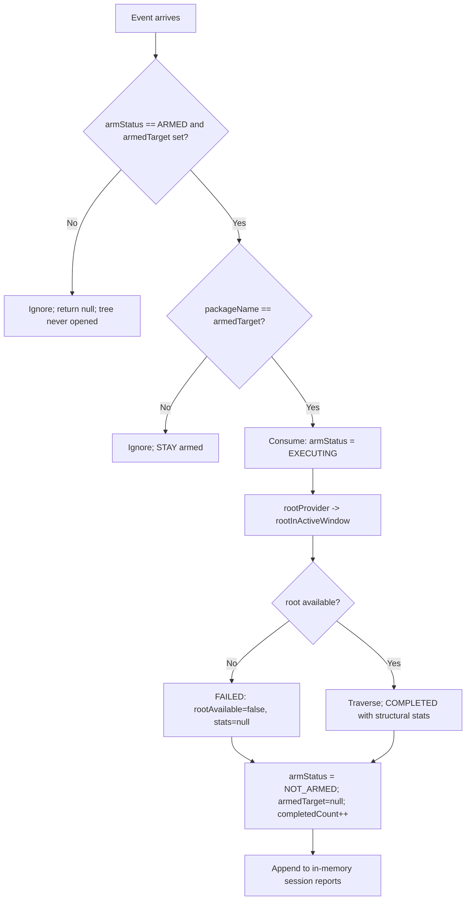

# 04 — Accessibility Inspection Flow

The exact sequence from launching the app to seeing a structural result, plus every failure path.
This matches `InspectionController` and `ChatInspectionService` precisely.

---

## The happy path (15 steps)

1. **App launch.** `GroomingResearchApp.onCreate()` → `ResearchStore.init()` loads two non-sensitive
   values: the consent decision and the previously chosen app under test. `MainActivity` shows the
   Home dashboard.
2. **Consent check.** `consentStatus` starts `NOT_GIVEN`. Start Inspection is disabled.
3. **Manual service enablement.** User taps Enable Accessibility Service → opens Settings → turns on
   the service → returns → taps Re-check status. `computeServiceEnabled` confirms it and
   `serviceEnabled = true`. On `onServiceConnected` the service narrows its own
   `serviceInfo.packageNames` to the selected target, sets `serviceBoundBySystem = true` and calls
   `forceDisarm()`.
3a. **Target selection.** On the Choose app under test screen the researcher picks one of the
   five allowlisted messaging packages (or types another package, which is recorded but still
   bounded by the allowlist). `ResearchStore.setTargetPackage()` persists that one package name and
   notifies the connected service to re-narrow. Selecting an app starts nothing.
4. **User presses Start One-Time Inspection.** `ResearchStore.startInspection()` →
   `controller.arm(consentAccepted = true, serviceEnabled = true, targetPackage = <selected>)`.
5. **Request becomes armed.** `armStatus = ARMED` and `armedTarget = <selected>` — the package is
   captured **now**, so changing the selection later cannot redirect a waiting inspection.
   Indicator: "Waiting for a qualifying accessibility event."
6. **Android sends an accessibility event.** The user brings the app under test to the foreground;
   because the config subscribes to window/focus events for that package, the OS delivers one.
7. **Service checks the package name.** `onAccessibilityEvent` reads `event.packageName`.
8. **Service checks whether an inspection is armed.** It calls
   `ResearchStore.handleAccessibilityEvent(pkg) { rootInActiveWindow?… }` → `controller.handleEvent`.
9. **The request is consumed.** Inside `handleEvent`, only if `armStatus == ARMED` **and**
   `packageName == armedTarget`, the state flips to `EXECUTING` **before** the tree is opened.
10. **Active root obtained.** The lazy `rootProvider()` runs → `rootInActiveWindow` → wrapped as a
    `RealAccessibilityNodeView`.
11. **Tree traversed.** `StructuralInspector.inspect(root)` walks breadth-first.
12. **Statistics calculated.** `nodesVisited`, `nodesWithText`, `nodesWithContentDescriptionOnly`,
    `textBearingNodes` (+ percentage), `emptyOrUnavailableTextNodes`, `totalTextCharacters`,
    `maxDepth`, `distinctNodeClasses`, `nodeClassCounts`, `unreadableChildNodes`, `truncated`,
    `notes`.
13. **Result displayed and reported.** `InspectionResult(outcome = COMPLETED)` is stored, published
    to the Results screen, and appended to the in-memory session report list; the
    Compatibility report screen renders the redacted text record. Logcat prints only the numbers.
14. **Back to idle.** `armStatus = NOT_ARMED`, `armedTarget = null`, `completedCount += 1`. It does
    **not** re-arm.
15. **Cancellation / failure** are handled at any earlier step (below).

## Sequence diagram

## Flowchart

## Failure / edge cases (what the code actually does)

| Situation | Behaviour | Where |
|---|---|---|
| Target app not active / no event | Arm stays ARMED until the user cancels or an event arrives; **no retries** | `handleEvent` returns null unless armed+match |
| Service disabled | `arm()` returns `SERVICE_REQUIRED`; cannot arm | `InspectionController.arm` |
| Consent not accepted | `arm()` returns `CONSENT_REQUIRED` | `InspectionController.arm` |
| No app under test selected (blank) | `arm()` returns `TARGET_REQUIRED`; cannot arm | `InspectionController.arm` |
| Selection changed while armed | The armed inspection keeps `armedTarget`; the new package's events are ignored | `handleEvent` |
| Active root null | `rootProvider()` yields null → outcome **FAILED**, `rootAvailable=false`, `stats=null`, reason set | `handleEvent` |
| Wrong package event | Ignored; **arm preserved** and the tree is never opened (asserted by `wrongPackageEventIsIgnoredAndStaysArmed`) | `handleEvent` |
| Request already consumed | Second event returns null; no second inspection | `handleEvent` guard |
| User cancels before event | `cancel()` → NOT_ARMED + a CANCELLED result, no traversal | `cancel` |
| A node's children cannot be read | Traversal continues, `unreadableChildNodes++`, a note records the depth and widget class | `StructuralInspector.inspect` |
| Tree exposes no labels at all | Still `COMPLETED`, with `textBearingNodes = 0` and a note — a valid negative compatibility result | `StructuralInspector.inspect` |
| Consent revoked | `revokeAndClear()` → disarm + clear results + clear session reports | `revokeAndClear`, `ResearchStore` |
| Process restart | `init()` loads consent + target only; `notifyServiceConnected()` calls `forceDisarm()` | `ResearchStore` |

## Why the order matters

- **Consume before inspect** (step 9 before 10): if we inspected first and consumed after, a second
  event during the traversal could trigger a second inspection — breaking the one-shot guarantee.
- **Lazy root provider** (step 10): the tree is only opened once we've decided to inspect, so we
  never even touch the app under test's window for an unarmed or non-target event. This is a privacy
  property as much as a correctness one.
- **Target captured at arm time** (step 5): the armed request holds its own package, so the
  researcher cannot accidentally inspect an app they did not press Start for, and changing the
  selection mid-flight cannot silently redirect a pending inspection.
- **Two-layer package restriction**: the config XML allowlists six messaging packages at the
  platform level, and `setServiceInfo()` narrows to one at connect time. Even if the runtime
  narrowing failed, the app still receives nothing from outside the allowlist, and `handleEvent`
  checks the armed target a third time.

## How the app avoids continuous inspection (and why it matters)

The arm is a single-use flag consumed on the first qualifying event, and nothing re-arms it. There
is no timer, no loop, no `typeWindowContentChanged` subscription, and no auto-retry. Since
2026-10-21 the single read is deferred by 1.5 s after the qualifying event (one `postDelayed`,
guarded by an arm token so a cancel or re-arm in that window drops it), which lets a transition
frame settle; it is still one read per arm, not a loop. This is why the app is a research instrument
rather than a monitor — it observes exactly one moment, only when the user asks, and then stops.

Next: [05_TEXT_PREPROCESSING_AND_ML_INTEGRATION.md](05_TEXT_PREPROCESSING_AND_ML_INTEGRATION.md).
