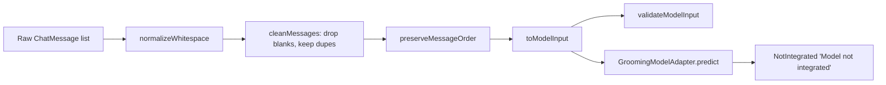

# 05 — Text Preprocessing and ML Integration

Explains the preprocessing pipeline end to end using the **synthetic** conversations, then shows
exactly where a real model would plug in. All transformations below match
`model/ConversationPreprocessor.kt`.

---

## 1. The raw input structure

```kotlin
data class ChatMessage(val speaker: String?, val text: String?, val timestampMillis: Long?)
```
A conversation is a `List<ChatMessage>`. Every field is nullable on purpose: a real corpus may lack
a speaker or a timestamp, and the pipeline must represent that absence instead of inventing a value.

## 2. Speaker labels and timestamps

- **Speaker** is kept verbatim when present; when absent the output line has no label (never "Unknown").
- **Timestamp** is never fabricated. It is used only for ordering, and only when *every* message has one.

## 3. Whitespace normalization

`normalizeWhitespace` = `text.trim().replace(Regex("\\s+"), " ")`. It collapses runs of spaces,
tabs, and newlines into single spaces and trims the ends. Null → empty string. Because `\s` matches
only ASCII whitespace, it never touches letters, emoji, or punctuation.

## 4. Blank-message handling

`cleanMessages` normalises each message's text and drops any that become blank (`""`, whitespace-only,
or null). Blank turns carry no information, so removing them is safe.

## 5. Unicode / Malayalam / emoji / punctuation preservation

There is no lowercasing, no accent folding, no transliteration, no emoji stripping. Kotlin strings
are UTF-16 and the only regex is whitespace, so Malayalam code points, emoji (including variation
selectors like `❤️`), and punctuation survive byte-for-byte. This is verified by the tests
`malayalamAndEmojiArePreservedExactly` and `punctuationIsPreserved`.

## 6. Message ordering

`preserveMessageOrder` uses a **stable sort by timestamp only when all messages have one**; if any
timestamp is missing it returns the supplied order unchanged. We never guess where an undated message
belongs.

## 7. Duplicates are kept

Two people both typing "ok" is a genuine pattern. `cleanMessages` does **not** deduplicate — the
`legitimateRepeatedMessagesArePreserved` test asserts three "ok" turns survive.

## 8. Serialization / model input

`toModelInput` writes one line per message: `"Speaker: body"` when a speaker exists, else just
`body`, joined by `\n`. Because whitespace (including newlines) was already collapsed, line count
equals message count — which `validateModelInput` checks.

---

## Worked example 1 — whitespace collapse

**Raw**
```
[1700000000000] A -> "hi   there"
[1700000060000] B -> "hello\n\n\nhow  are\n   you"
[1700000120000] A -> "\tI   am   fine   "
```
**After normalizeWhitespace**
```
"hi there"
"hello how are you"
"I am fine"
```
**Final model input**
```
A: hi there
B: hello how are you
A: I am fine
```

## Worked example 2 — blank removal

**Raw**
```
[...000] A -> ""
[...060] B -> "   "
[...120] A -> null
[...180] B -> "Are you still there?"
[...240] A -> "Yes."
```
**After cleanMessages** (first three dropped)
```
B: "Are you still there?"
A: "Yes."
```
**Final model input**
```
B: Are you still there?
A: Yes.
```

## Worked example 3 — chronological repair (shuffled input)

**Raw (as supplied, out of time order)**
```
A -> "Third turn (timestamp later)"   ts=+120
B -> "First turn (earliest timestamp)" ts=+0
A -> "Fourth turn"                     ts=+180
B -> "Second turn"                     ts=+60
```
**After preserveMessageOrder** (all timestamps present → stable ascending sort)
```
B -> "First turn (earliest timestamp)"
B -> "Second turn"
A -> "Third turn (timestamp later)"
A -> "Fourth turn"
```
**Final model input**
```
B: First turn (earliest timestamp)
B: Second turn
A: Third turn (timestamp later)
A: Fourth turn
```

---

## 9. Preprocessing ≠ inference

Preprocessing turns messy text into a consistent string. Inference is a **trained model** deciding
whether that string looks like grooming. This project does the first and only scaffolds the second.

## 10. How the current module differs from a trained detector

`ConversationPreprocessor` has no weights and makes no judgement. `PlaceholderGroomingModelAdapter`
returns `ModelPrediction.NotIntegrated("Model not integrated")` and never a score. Nothing here can
label a conversation as a grooming incident.

## 11. What you must change to integrate the real BTP model

1. Add an implementation of `GroomingModelAdapter` (e.g. `BertGroomingModelAdapter`) under a new
   `model/inference/` package.
2. Load your **fine-tuned weights** and the **same tokenizer** used at training — do not invent one.
3. Feed it `ConversationPreprocessor.preprocess(messages)` output; ensure that string is built by the
   **identical** code path used to build your training examples.
4. Return `ModelPrediction.Scored(label, confidence)` from real inference.
5. Swap the injected adapter in `PreprocessingLabScreen(modelAdapter = ...)`.

## 12. Training-time vs inference-time preprocessing

The single most common silent bug in ML apps is preprocessing drift: the inference code lowercases
or strips emoji but the training code didn't (or vice versa), so the model sees inputs it never
trained on. Because this module is deterministic and unit-tested, you can freeze its behaviour and
reuse the exact same functions in your training script.

## 13. How conversation context may be represented later

The current `toModelInput` preserves order and speaker, which is enough for a sequence model to
learn turn context. If your model needs explicit structure (e.g. speaker tokens, per-turn boundaries,
or a sliding window), extend `toModelInput` behind a flag and mirror that change in training. Do not
assume a window size or label set — those come from your model.

## 14. Why the lab uses synthetic data (and what that does NOT prove)

Synthetic data proves the **pipeline** is correct and deterministic. It does **not** prove that real
chat messages can be extracted, that speakers/timestamps can be recovered from an accessibility tree,
or that detection works in the wild. Those are separate, unverified claims.

The **authorized-import** screen exists for the one case synthetic data cannot cover: running the
pipeline on text a researcher is actually permitted to use. Three rules keep it honest — it is a
separate screen, it is banner-labelled *"NOT OBSERVED FROM THE APP UNDER TEST"*, and its input lives
in memory only. `AuthorizedTextParser` splits on the first `": "` and never invents a speaker or a
timestamp; a line without a separator simply becomes an unlabeled turn.



**In plain words:** clean → order → serialise → (optionally) hand to a model. Today the model step
honestly stops at "not integrated".

Next: [06_TESTING_AND_RESULTS.md](06_TESTING_AND_RESULTS.md).
