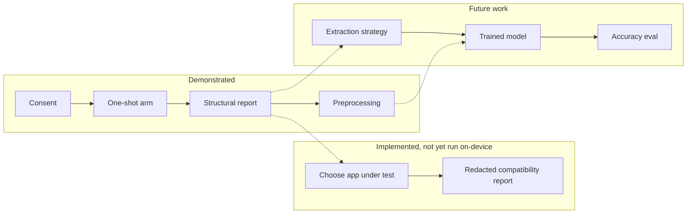

# 08 — Limitations and Future Work

Honest separation of what is **demonstrated**, what is **assumed/unverified**, and what is **future
work**. Bring this to the viva; examiners reward candour.

---

## 1. Demonstrated (verified in this environment)

- The project **builds** a debug APK (`app-debug.apk`, 12,032,138 bytes).
- **57 unit tests pass** covering consent, cancellation, the target-app gate, wrong package,
  null/empty/multi-label trees, depth, node cap, unreadable children, the widget-class histogram,
  report redaction, the authorized-text parser, and every preprocessing rule.
- The APK **installs and launches** on an API-26 emulator with no crash; the UI renders, including
  the new target-selection and report screens.
- **Consent** is accepted and **persists** across a forced restart, as does the chosen **app under
  test** (the only two keys in SharedPreferences).
- The UI **never fakes success**: with the service off it shows "Not enabled / unverified" and
  disables Start; the armed/verified state is only reported after a real check.
- Preprocessing is **deterministic** and preserves Unicode/emoji/order/duplicates (proven by tests).
- Report **redaction is proven**, not asserted: `CompatibilityReportTest` renders a report for a tree
  whose nodes carry a distinctive marker string and fails if that string appears anywhere in the
  output.

## 2. Implemented but NOT exercised on-device here (unverified assumptions)

- The **live compatibility inspection** (choose app → arm → app event → root → structural report) —
  run three times on device (R1–R3). It established that a conversation screen in Instagram Lite
  exposes 16 text nodes / 205 characters and in Instagram 18 / 245, while a non-chat screen exposed
  none. What it did **not** establish is that those characters are message bodies — see the
  text-bearing-node-is-not-a-message point in §3. Rows still PENDING in
  [11_REAL_APP_COMPATIBILITY_REPORT.md](11_REAL_APP_COMPATIBILITY_REPORT.md) must stay blank; treat any
  app-specific number not in that log as **not measured**.
- **Service-enablement detection on a real device** — the code checks AccessibilityManager and
  Settings.Secure, and the Settings toggle has now been performed by hand by the researcher (the
  harness still refuses to do it programmatically — see `docs/11` §7). Android
  does not permit the app (or our tooling) to enable it programmatically, and we did not work around
  that; see §7 of the compatibility report.
- **`setServiceInfo()` runtime narrowing** — implemented and reviewed, but only observable once the
  service is actually bound on a device.

## 3. Fundamental limitations of the approach

- **Accessibility ≠ extraction.** A tree exposes *structure*, not a clean list of messages, speakers,
  or timestamps. There is no reliable mapping from nodes to messages, and node text does not
  reliably carry sender names or times.
- **A text-bearing node is not a message.** It may be a button label, a tab title, a nav item, or an
  icon description. The counts measure *exposure*, not conversation size.
- **Missing text.** Many visible elements expose no `text`/`contentDescription`; a node can be a
  message visually yet contribute nothing to the text-bearing count. An inaccessible screen is a
  legitimate result and is reported as such rather than worked around.
- **Version variance.** Android releases and app updates change what is exposed; results are not
  stable across versions and were not measured across versions here.
- **Off-screen content.** Lists only expose rendered items, so a long conversation is not fully in the
  tree at any one instant — and we do not scroll (that would be continuous collection).
- **No ground truth.** Without labelled real conversations we cannot report extraction coverage or
  accuracy — and we must not pretend to. The coverage method proposed in §9 of the compatibility
  report gives an upper bound only.
- **The allowlist is deliberate.** Only six packages can ever be inspected; the free-text package
  field is recorded but still cannot widen the platform-level `packageNames` filter. That is a
  restriction we chose, not an oversight.

## 4. Limitations of the preprocessing demonstration

- It proves the **pipeline** is correct on **synthetic** inputs. It does **not** prove the pipeline is
  the one your real model expects — that depends on matching training-time preprocessing.
- It does not tokenize, chunk, or window text; those are model-specific and intentionally not assumed.
- The **authorized-import** screen parses `Speaker: message` lines only. A pasted conversation with no
  separators yields unlabeled lines — the parser never guesses a speaker, and it never invents a
  timestamp.
- Parsed/imported text lives in memory for the session only. There is no save, export, or share path.

## 5. Limitations of the model integration

- There is **no model**. The adapter returns "Model not integrated". No predictions, no confidences,
  no labels are produced, and none should be shown.

## 6. Privacy & consent considerations that remain

- The consent screen is an in-app disclosure, not a substitute for formal ethics approval / university
  IRB sign-off if real user data is ever involved.
- **Conversations involving other people need their consent too.** The import screen says this
  explicitly; a researcher pasting a real thread is responsible for the authorisation behind it.
- Even structural metadata about a person's app usage can be sensitive; the one-shot, package-restricted,
  no-storage design minimises but does not eliminate this.
- Nothing is persisted beyond two non-sensitive booleans/strings (consent, chosen package). Reports
  are deliberately memory-only, so a force-stop loses them — that is the intended behaviour.
- Real deployment would require data-retention, security, and legal review.

## 7. Future work (a credible roadmap)

0. **Run the pending compatibility experiments** (RC-01…RC-05 in the compatibility report) on the
   emulator with Google Messages, then across the other allowlisted apps, and fill in the result
   table with measured numbers.
1. **Connect the trained model:** implement `GroomingModelAdapter` with the exact tokenizer +
   preprocessing used in training; return `Scored`.
2. **Define an extraction strategy** (if pursued) under proper ethics approval — likely not via
   accessibility at all, but via exported datasets or a consented test harness.
3. **Coverage measurement:** build a labelled set and report recall/precision of any extraction.
4. **Multi-version testing:** run the structural experiment across Android and app versions and
   report variance.
5. **Context modelling:** extend `toModelInput` to encode turn structure/windowing the model needs.
6. **Hardening:** add instrumentation tests on a real device for the service lifecycle, including
   `setServiceInfo()` narrowing and `onInterrupt` behaviour.

**In plain words:** the left side is what this project proves; the middle is built and unit-tested
but awaiting a manual on-device run; the right side is what remains. The dashed lines are the seams
where future work attaches — they are not yet connected.

Next: [09_DEVELOPMENT_JOURNAL.md](09_DEVELOPMENT_JOURNAL.md). Then read
[11_REAL_APP_COMPATIBILITY_REPORT.md](11_REAL_APP_COMPATIBILITY_REPORT.md) for the experiment
procedure and the pending result log.
