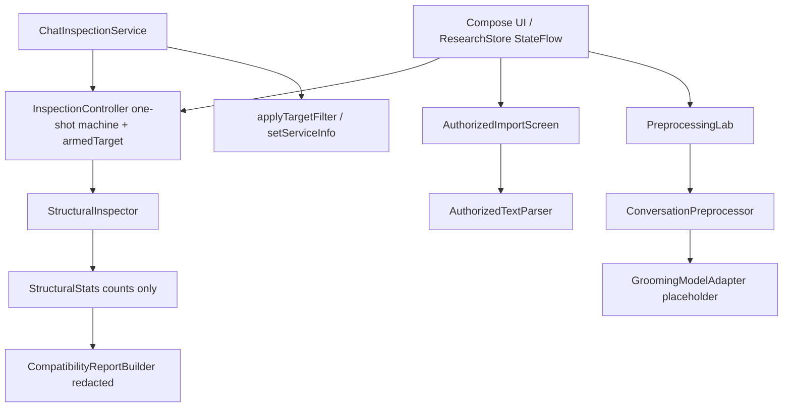

# 10 — Quick Revision Notes

Last-minute sheet. Read this the morning of your viva.

---

## Definitions (one line each)

- **AccessibilityService** — system-bound component that receives events about other apps' UI.
- **AccessibilityEvent** — a notification that something happened in a package (type + packageName).
- **AccessibilityNodeInfo** — the accessibility-visible description of one UI element (text, bounds, children).
- **Accessibility tree** — nodes arranged parent→children describing a window's structure.
- **rootInActiveWindow** — the root node of the focused window; traversal entry point; can be null.
- **One-shot / armed** — a single-use permission the user grants; consumed on the first qualifying event.
- **Compatibility test** — does the app expose structure/text to accessibility APIs at all? Measures
  exposure, never accuracy. Distinct from **model evaluation**, which needs labelled data and a model.
- **App under test / `armedTarget`** — the one allowlisted package chosen before arming.
- **Preprocessing** — cleaning + ordering + serialising text for a model.
- **Inference** — a trained model scoring preprocessed text. **Not implemented here.**

## Important Android classes / APIs

- `AccessibilityService` (`onServiceConnected`, `onAccessibilityEvent`, `onInterrupt`, `onDestroy`)
- `AccessibilityNodeInfo` (`getChildCount`, `getChild`, `getText`, `getContentDescription`, `getClassName`)
- `AccessibilityEvent.getPackageName()`
- `AccessibilityManager.getEnabledAccessibilityServiceList(...)` + `Settings.Secure.ENABLED_ACCESSIBILITY_SERVICES`
- `AccessibilityServiceInfo` config attributes (`packageNames`, `canRetrieveWindowContent`, `accessibilityEventTypes`)
- `AccessibilityService.setServiceInfo(...)` — runtime **narrowing** of `packageNames` (never widening)
- `PackageManager.getPackageInfo(...)` inside `runCatching` — is the chosen app even installed

## Important project symbols

- `InspectionController.arm / cancel / handleEvent / revokeAndClear / forceDisarm`
- `InspectionController.armedTarget` — package captured at arm time (`@Volatile`, private setter)
- `StructuralInspector.inspect(root): StructuralStats?`
- `StructuralStats` — visited, text-bearing, label-only, total chars, availability %, class histogram,
  distinct classes, unreadable children, notes, truncated
- `AccessibilityNodeView` (testable seam, 5 methods incl. `className()`) + `RealAccessibilityNodeView`
- `ResearchStore` (StateFlow singleton), `ResearchUiState` (`targetPackage`, `armedTarget`, `reports`)
- `ChatInspectionService.applyTargetFilter(package)` — `setServiceInfo` narrowing
- `CompatibilityReportBuilder.build(result, …)` + `PRIVACY_FOOTER`
- `AuthorizedTextParser.parse(raw)` — `Speaker: message`, first separator only, never invents a timestamp
- `ConversationPreprocessor.normalizeWhitespace / cleanMessages / preserveMessageOrder / toModelInput / validateModelInput`
- `GroomingModelAdapter` + `PlaceholderGroomingModelAdapter` → "Model not integrated"
- `AppConstants.TARGET_OPTIONS` (6-package allowlist, incl. `com.instagram.lite`), `MAX_TRAVERSAL_NODES = 5000`,
  `MAX_CLASS_HISTOGRAM_KEYS = 40`, `MAX_NOTES = 6`, `MAX_REPORTS_KEPT = 20`

## Architecture in one diagram



## Inspection workflow in 10 steps

1. Launch → init loads consent + chosen package. 2. Accept consent. 3. Enable service + re-check.
4. Choose the app under test (verified installed). 5. Start → `armedTarget` captured, state ARMED.
6. Open that app → event → package check → consume (EXECUTING). 7. `rootInActiveWindow` → BFS traverse.
8. Stats → COMPLETED/FAILED → report appended in memory. 9. NOT_ARMED (no re-arm). 10. Cancel/Stop
disarms immediately at any point before consumption.

## Preprocessing workflow in 5 steps

1. normalizeWhitespace 2. cleanMessages (drop blanks, keep dupes) 3. preserveMessageOrder (sort by ts
if all present) 4. toModelInput (one line per message) 5. validateModelInput (non-blank, line count).

## Key implementation decisions (and why)

- **Consume before inspect** → guarantees exactly one inspection.
- **Lazy root provider** → never open the tree for unarmed/non-target events (privacy; asserted by a
  test that records whether the tree was opened).
- **Target captured at arm time** → changing the selection mid-experiment cannot redirect it.
- **Three package layers** → XML allowlist (platform) → `setServiceInfo` narrowing → `armedTarget`.
- **`<queries>`, not `QUERY_ALL_PACKAGES`** → least-privilege package visibility.
- **No `recycle()`** → deprecated/no-op on API 34+; rely on not retaining nodes.
- **State machine Android-free** → unit-testable without a device.
- **Class names but never text** → widget classes are non-sensitive metadata; message content is not.
- **Report redaction is tested** → a marker string in node text must never appear in a report.
- **No INTERNET permission** → cannot transmit; provable.
- **Conservative preprocessing** → must match future training-time preprocessing.
- **minSdk 24** → installs on the API-26 emulator.

## Essential limitations (say these)

- Structural counts ≠ messages; a text-bearing node may be a button, tab, or icon description.
- Extraction is not implemented; availability is an *upper bound*, not coverage.
- No model; "Model not integrated"; no accuracy claims.
- **On-device compatibility: R1–R8 recorded; RC-04 still PENDING.** The Settings toggle was performed
  by the researcher by hand — never by the harness, which refused programmatic enabling.
- **The experiment's real finding is per-screen availability.** Conversation screens: Lite 16 text
  nodes / 205 chars, Instagram 18 / 245. A non-chat screen (R1): 0 / 0. Reporting R1 alone would have
  produced the false conclusion "Instagram exposes no text". Never quote `textBearing` on its own — it
  merges real text with `contentDescription` labels.
- **R4–R8 (Google Messages) are measured but unlabelled**, so no cross-app sentence about Messages is
  published yet. R4 (8 nodes, 1 text node) is not a messaging screen and is excluded from comparison.
- **Determinism, stated precisely:** R7/R8 back-to-back are identical, but R5/R7 — same 46-node screen
  seven minutes apart — differ (`withText` 4→5, `chars` 70→74) while node count, depth and classes
  held. So the *traversal* is deterministic; the *screen* is not immutable.
- Text may be unavailable; results vary by Android/app version.

## Essential commands

```
$env:JAVA_HOME = "C:\Program Files\Android\Android Studio\jbr"
.\gradlew :app:assembleDebug :app:testDebugUnitTest
adb install -r app\build\outputs\apk\debug\app-debug.apk
adb shell am start -n com.example.groomingresearchdemo/.MainActivity
adb logcat -s GroomingResearchDemo
```

## Real results to quote

- APK: `app/build/outputs/apk/debug/app-debug.apk`, **12,032,138 bytes** (clean build).
- Tests: **57 passed, 0 failed, 0 errors, 0 skipped** (15 controller, 13 inspector, 13 preprocess,
  9 authorized-parser, 4 report-redaction, 3 model placeholder).
- Emulator: installed + launched on API 26 and API 35, no crash; consent and chosen package persisted
  across restart. On the API 35 device **both** `com.instagram.lite` and `com.instagram.android` are
  installed, along with Google Messages — which is why the allowlist carries both Instagram variants
  and the researcher must pick the one actually opened.
- On-device structural inspection: **8 runs (R1–R8).** R2 Instagram Lite 533.0.0.9.105 — 80 nodes,
  depth 5, `withText=16`, `chars=205`, 5 classes. R3 Instagram 452.0.0.48.64 — 55 nodes, depth 6,
  `withText=18`, `descOnly=12`, `chars=245`, 8 classes. R1 (non-chat screen) — 19 nodes, depth 9,
  `withText=0`, `chars=0`. R4–R8 Google Messages — 8, 46, 20, 46, 46 nodes, screens **unlabelled** and
  therefore not yet comparable. All runs: `root=true`, `unreadable=0`, `truncated=false`.

## 20 most likely panel questions (short answers)

1. **What does the app detect?** Nothing yet — scaffolding; no model.
2. **Why accessibility, not the app's DB?** DB is private/encrypted; the tree is the only sanctioned on-screen view, used for structure only.
3. **Does it read message text?** It reads text only to test blankness and add its length to a count; nothing is stored, logged, or sent.
4. **How is one inspection enforced?** ARMED consumed → EXECUTING → NOT_ARMED; never auto-re-arms.
5. **Why can rootInActiveWindow be null?** Transitions/no focused window; reported as FAILED, not retried.
6. **Node count = message count?** No, no fixed ratio.
7. **How do you stop continuous collection?** One-shot arm, no timer, package-restricted events, no scroll.
8. **How is consent obtained?** Disclosure screen + explicit Accept; Decline keeps it disabled; Revoke clears.
9. **How do you prove no data leaves?** No INTERNET permission declared.
10. **Why synthetic data?** Real DMs are private/out of scope; proves pipeline only.
11. **Why keep duplicate messages?** Repetition can be signal; dedup erases it.
12. **How is Malayalam/emoji preserved?** Only whitespace touched; no lowercasing/transliteration.
13. **Is there a model?** No — placeholder returns "Model not integrated".
14. **How to add the model?** Implement `GroomingModelAdapter`, same tokenizer + preprocessing as training, return `Scored`.
15. **What did you actually test?** 57 unit tests + APK build + emulator install/launch/persistence, and **one** on-device inspection (R1) that returned structure but zero text nodes.
16. **Which app did you test compatibility against?** Google Messages is installed on the AVD and is the intended first target; nothing has been measured yet, so no claim is made.
17. **Why an allowlist instead of any app?** The `packageNames` config is a platform-enforced outer bound; widening it would turn a research instrument into a monitor.
18. **How do you know the report has no private text?** `CompatibilityReportTest` plants a marker in node text and asserts it never appears in the rendered report.
19. **Why not just enable the service with adb?** Android requires a deliberate human act; the attempt was refused by policy and not worked around. That refusal is recorded in docs/11 §7.
20. **How would you measure real coverage?** Transcript `T` vs text-bearing nodes `B`, reported as `B/T` — an upper bound only, since labels include buttons and tabs.

## Reading order if time is short

`00` → `02` → `11` → `06` → this sheet. Skim `03`/`04`/`05` for details you might be asked to expand on.
